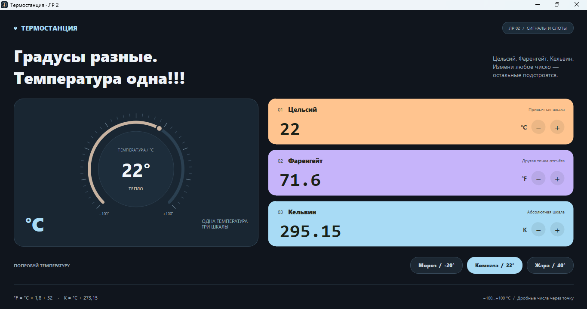
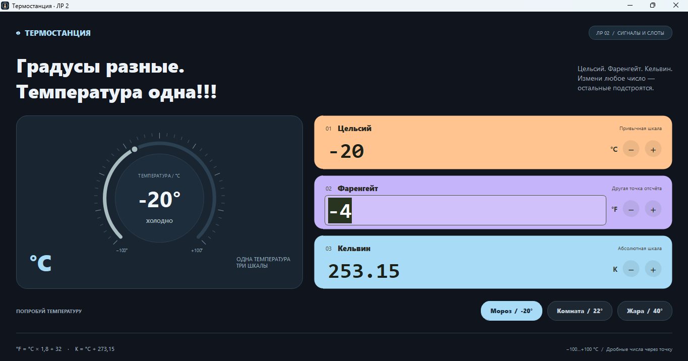
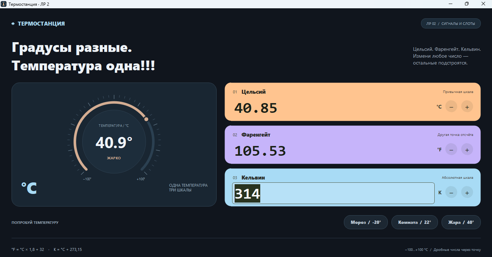

# Лабораторная работа № 2 

Приложение переводит температуру между градусами Цельсия, Фаренгейта и кельвинами. Если изменить одно поле, два других сразу пересчитываются. Работа посвящена сигналам и слотам в PyQt5.

## Что умеет программа

- Принимает значения в любой из трёх шкал.
- Поддерживает отрицательные и дробные числа.
- Изменяет значения кнопками «−» и «+».
- Показывает температуру на круговом термометре и меняет его цвет.
- Содержит готовые примеры: «Мороз», «Комната» и «Жара».

В приложении выбран диапазон от −100 до +100 °C. Поля показывают до трёх знаков после точки. Дробные числа вводятся через точку.

## Как это работает

Поле ввода отправляет сигнал `value_edited`. Подключённый к нему слот пересчитывает температуру. Затем сигнал `changed` передаёт новые значения в окно, где обновляются поля и термометр.

Для соединения используются `pyqtSignal`, `pyqtSlot` и `connect()`. При обновлении полей `QSignalBlocker` предотвращает повторную цепочку сигналов.

Формулы пересчёта: 
`F = C * 9 / 5 + 32`, 
`K = C + 273.15`.

## Запуск

Команды выполняются в PowerShell из корня репозитория, где находится папка `lr2`:

```powershell
.\.venv\Scripts\python.exe -m pip install -r requirements.txt
.\.venv\Scripts\python.exe lr2/main.py
```

Если окружение ещё не создано, перед этими командами выполни `py -m venv .venv`.

## Скриншоты

### Начальное состояние

22 °C = 71,6 °F = 295,15 K.



### Изменение температуры по Фаренгейту

В поле «Фаренгейт» введено −4 °F. Остальные поля показывают −20 °C и 253,15 K.



### Изменение температуры в кельвинах

В поле «Кельвин» введено 314 K. Остальные поля показывают 40,85 °C и 105,53 °F.



