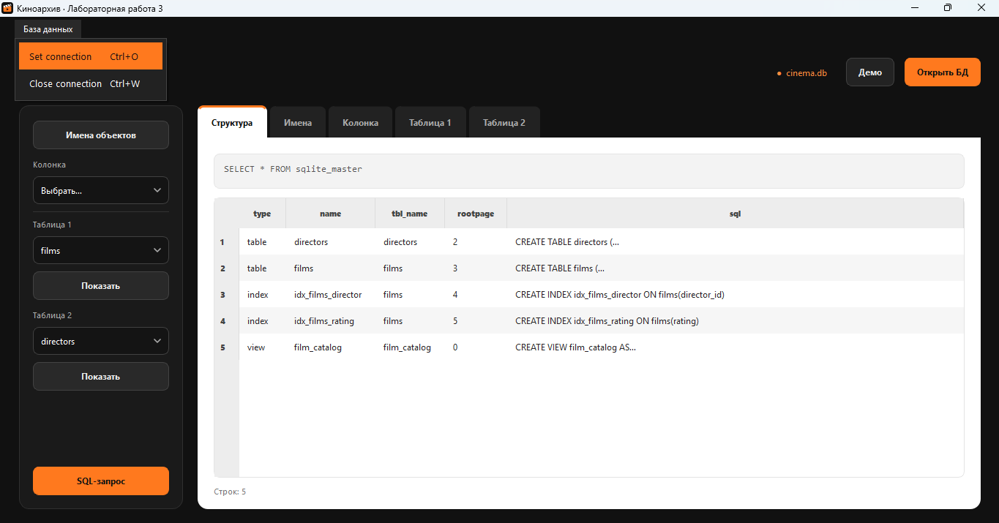
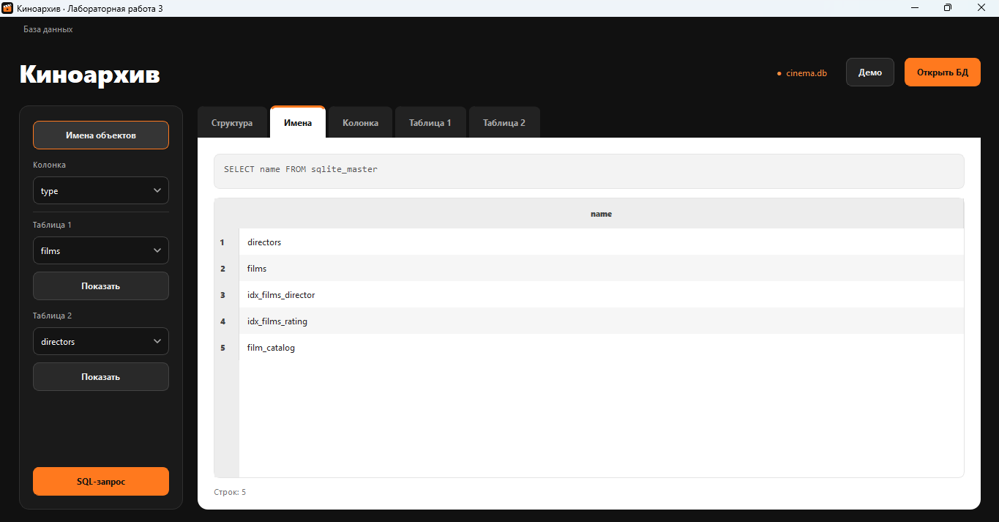
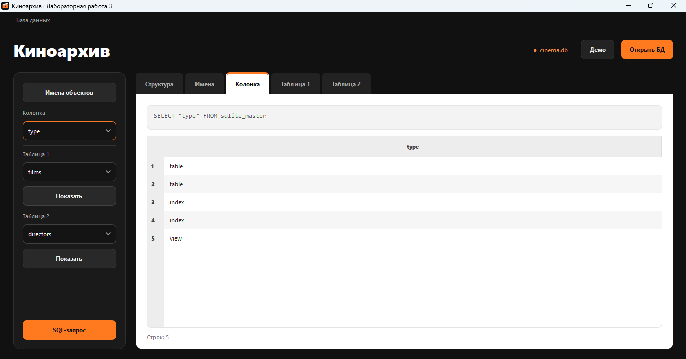
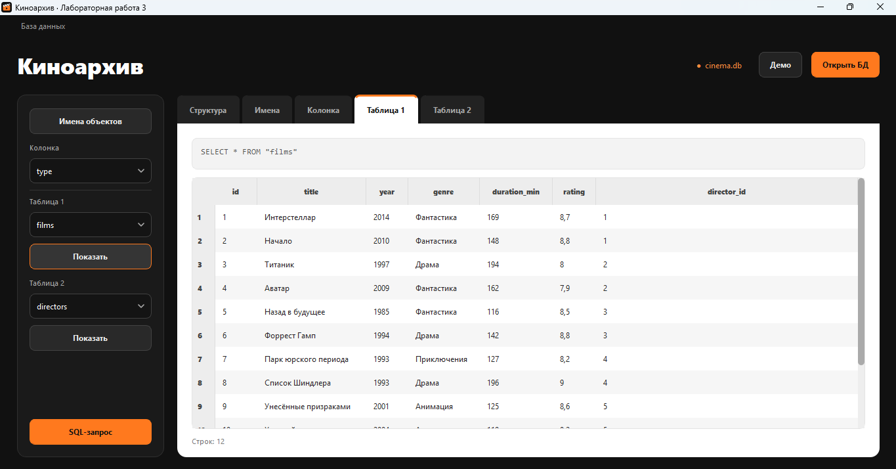
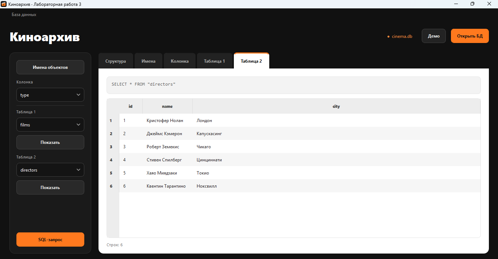
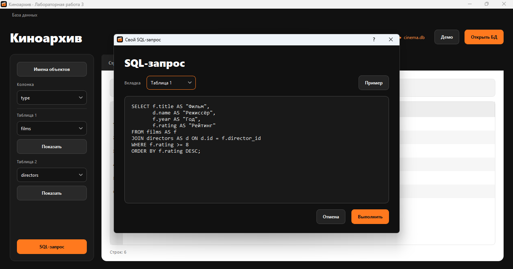
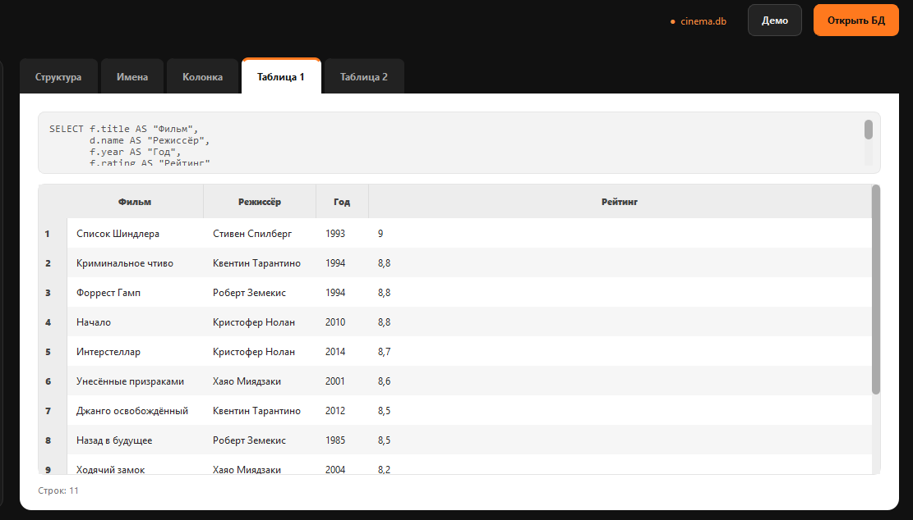
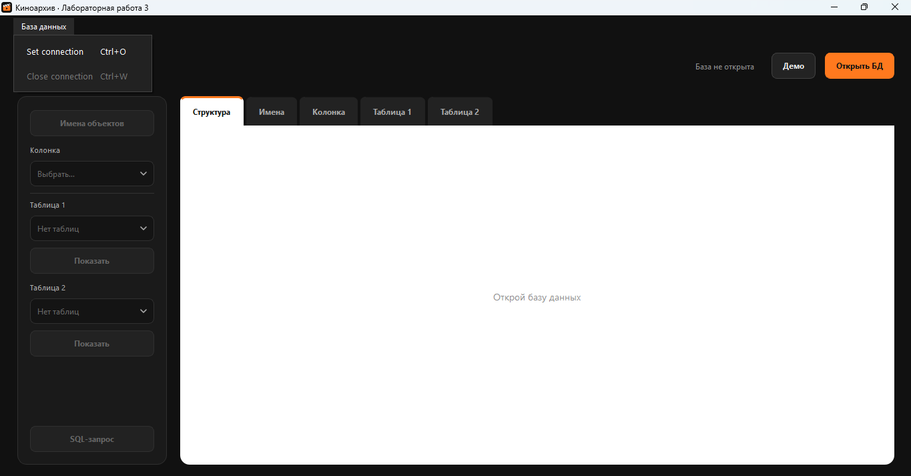

# ЛР 3 — Киноархив

Приложение на Python и PyQt5 для просмотра SQLite-баз. SQL-запросы выполняются через `QtSql`, результаты выводятся в `QTableView` с помощью `QSqlQueryModel`. Пять вкладок сохраняют результаты независимо друг от друга. Интерфейс оформлен в чёрном, белом и оранжевом цветах.

В комплекте — учебная база `data/cinema.db`: 12 реальных фильмов, 6 режиссёров, два индекса и представление. Среди фильмов — «Интерстеллар», «Начало», «Титаник», «Назад в будущее» и «Ходячий замок». Можно выбрать и другую SQLite-базу.

Поле `rating` содержит сохранённые оценки IMDb, которые не обновляются автоматически. Поле `city` у режиссёров — город рождения. Источники данных и дата проверки указаны в [data/SOURCES.md](data/SOURCES.md).

## Запуск

Команды для PowerShell из корня репозитория, где находятся `lr1`, `lr2`, `lr3`:

```powershell
.\.venv\Scripts\python.exe -m pip install -r requirements.txt
.\.venv\Scripts\python.exe lr3/main.py
```

Зависимость — `PyQt5==5.15.11`. SQLite-драйвер входит в PyQt5; отдельный сервер БД не нужен.

## Выполнение задания

Вкладки Tab1–Tab5 из условия названы «Структура», «Имена», «Колонка», «Таблица 1» и «Таблица 2». Кнопка bt1 подписана «Имена объектов», а bt2 и bt3 — «Показать» под соответствующим списком таблиц.

| Требование | Что реализовано |
| --- | --- |
| Set connection | Пункт меню «База данных → Set connection» открывает QFileDialog для выбора файла БД |
| Close connection | Очищает все пять результатов, SQL-тексты и списки, закрывает и удаляет соединение; кнопки запросов отключаются |
| QTabWidget | Пять вкладок, при запуске пустые |
| Tab1 после подключения | Автоматически выполняется `SELECT * FROM sqlite_master` |
| bt1 → Tab2 | Выполняется `SELECT name FROM sqlite_master` |
| QComboBox → Tab3 | Выбор `type`, `name`, `tbl_name`, `rootpage` или `sql` выполняет `SELECT "выбранная_колонка" FROM sqlite_master` |
| bt2 → Tab4 | Показывает таблицу из первого списка; в демо по умолчанию `SELECT * FROM "films"` |
| bt3 → Tab5 | Показывает таблицу из второго списка; в демо по умолчанию `SELECT * FROM "directors"` |
| Бонус: модальный запрос | Кнопка «SQL-запрос» открывает QDialog через `exec_()`. Можно ввести запрос и выбрать Tab2–Tab5 для результата |

Горячие клавиши: `Ctrl+O` — выбор БД, `Ctrl+W` — отключение, `F1`/`F2`/`F3` — bt1/bt2/bt3, `Ctrl+Enter` — выполнение запроса в диалоге.

## Свой SQL-запрос

Пример объединяет две связанные таблицы, отбирает записи и сортирует результат:

```sql
SELECT f.title AS "Фильм",
       d.name AS "Режиссёр",
       f.year AS "Год",
       f.rating AS "Рейтинг"
FROM films AS f
JOIN directors AS d ON d.id = f.director_id
WHERE f.rating >= 8
ORDER BY f.rating DESC;
```

Поддерживаются одиночные запросы `SELECT` и `WITH … SELECT`. База открывается для чтения: изменение данных в этой работе не предусмотрено. Ошибку запроса диалог показывает под полем ввода; предыдущий успешный результат сохраняется. Для новой попытки исправьте текст. Для выхода без выполнения нажмите «Отмена» или Esc.

`sqlite_master` — системный каталог объектов SQLite. В поле `sql` хранится SQL создания таблицы, индекса или представления. Полный длинный текст можно увидеть в подсказке ячейки. Столбцы таблиц можно расширять мышью; большие результаты догружаются при прокрутке. Знак `+` возле количества строк означает, что ещё не все записи загружены.

## Скриншоты

**Tab1 — структура БД сразу после подключения**



**Tab2 — результат bt1**



**Tab3 — выбор колонки type**



**Tab4 — таблица films по кнопке bt2**



**Tab5 — таблица directors по кнопке bt3**



**Бонус — модальное окно ввода SQL**



**Результат JOIN в Tab4**



**После Close connection**



В приложении используются классы из лекций: `QSqlDatabase`, `QSqlQuery`, `QSqlQueryModel`, `QTableView`, `QTabWidget`, `QComboBox`, `QFileDialog` и `QDialog`. Модели сначала очищаются через `clear()`, затем соединение закрывается и удаляется через `removeDatabase()`.

## Проверка

```powershell
.\.venv\Scripts\python.exe -m unittest discover -s lr3/tests -v
```

13 проверок: исходное состояние, выбор БД через диалог, все обязательные запросы, модальный JOIN, ошибки SQL, очистка и повторное подключение, неверный файл и отмена, пустая БД, имена таблиц с кавычками, загрузка 1500 строк, режим чтения и горячие клавиши.

Тесты работают с настоящим драйвером QSQLITE и сравнивают результаты с независимыми SQL-запросами. Диалоги выбора файла и сообщения об ошибках в тестах заменены автоматическими ответами.
