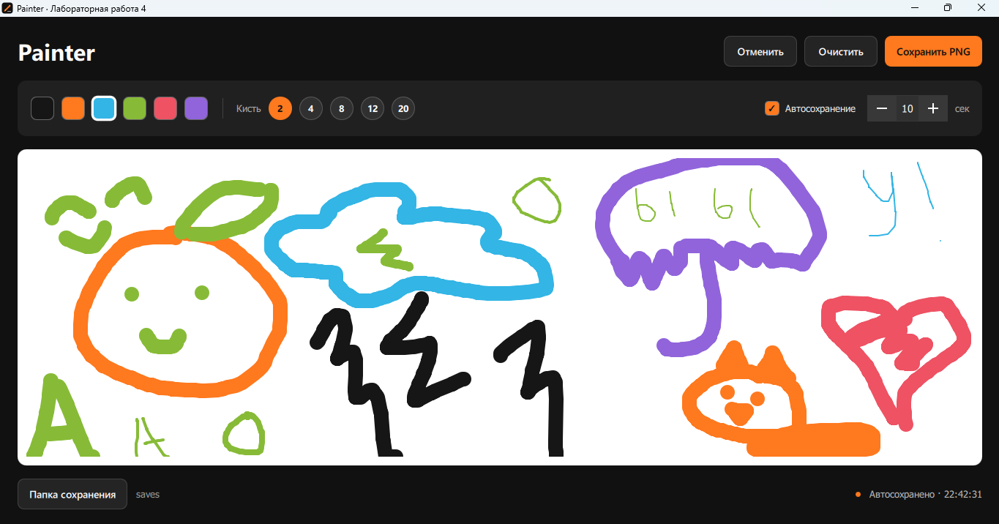
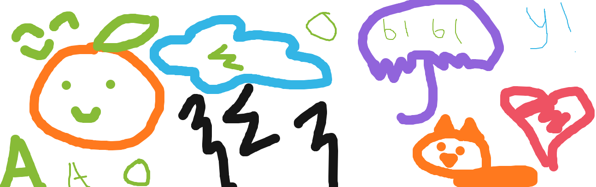

# ЛР 4 — Painter

Приложение для рисования на Python и QML. Основа — выданный каркас `lab4_template`: сохранены класс `Interface`, QML-холст и компоненты выбора цвета и толщины кисти.

Главное задание выполнено в классе **Interface**: `QTimer` по заданному интервалу сохраняет содержимое `Canvas` в PNG-файл. 

## Запуск

Из корня репозитория:

```powershell
.\.venv\Scripts\python.exe -m pip install -r requirements.txt
.\.venv\Scripts\python.exe lr4/main.py
```

Если окружения ещё нет: `py -m venv .venv`. Нужен только `PyQt5==5.15.11`, как в предыдущих работах. Файлы QML загружаются относительно `main.py`, поэтому запуск не зависит от текущей папки терминала.

## Что умеет программа

- Рисование мышью, выбор цвета и толщины кисти.
- Автосохранение каждые 10 секунд по умолчанию; интервал можно изменить от 1 до 300 секунд.
- Включение и отключение автосохранения.
- Выбор папки и ручное сохранение отдельного PNG.
- Отмена последнего штриха и очистка холста с подтверждением.
- Сообщение о результате сохранения и проверка несохранённых изменений при выходе.

По умолчанию создаётся файл **`lr4/saves/autosave.png`**. После изменений он обновляется при следующем срабатывании таймера. Без изменений повторной записи нет. Папка создаётся автоматически при первом сохранении.

`autosave.png` содержит последнюю сохранённую версию, в том числе после следующего запуска программы. Для хранения разных рисунков нажимайте **«Сохранить PNG»** и выбирайте отдельные имена. При запуске холст пустой: загрузка рисунков в этой работе не реализована.

Сохраняется только область рисования с белым фоном, без кнопок и панелей. Полный путь к папке или последнему файлу можно увидеть в подсказках внизу окна. После ошибки изменения остаются несохранёнными, и таймер повторит попытку.

Горячие клавиши: **Ctrl+S** — сохранить PNG, **Ctrl+Z** — отменить штрих.

## Как выполнено задание

В `Interface.__init__()` создаётся таймер:

```python
self.timer = QTimer(self)
self.timer.setInterval(self._interval * 1000)
self.timer.timeout.connect(self.save_canvas)
```

После загрузки QML метод `attach_canvas()` получает холст и запускает таймер. При рисовании QML вызывает `_backend.markDirty()`, отмечая изменения.

По сигналу `timeout` метод `save_canvas()` вызывает `_save()`. Python определяет путь, создаёт папку и через `QMetaObject.invokeMethod()` вызывает QML-функцию `saveToFile()`. Она дорисовывает актуальные штрихи и вызывает `Canvas.save()`.

Сначала создаётся временный PNG рядом с итоговым файлом. Только после успешной записи Python заменяет `autosave.png` через `os.replace()`. Если запись завершилась ошибкой, предыдущая копия сохраняется, а в окне появляется сообщение.

Штрихи хранятся в QML как наборы точек. Поэтому рисунок можно заново отобразить после изменения размера окна, отмены штриха или перед сохранением.

## Скриншоты

Приложение после автосохранения:



PNG, который действительно записала программа:




## Проверка

```powershell
.\.venv\Scripts\python.exe -m unittest discover -s lr4/tests -v
```

13 проверок с настоящими Canvas и QTimer: запись и повторное обновление PNG, пауза, изменение интервала, рисование мышью, цвета и толщина, отмена, очистка, изменение размера, выбор пути, ручное сохранение, ошибки записи и выход. Проверяются также размеры и пиксели сохранённого изображения. Файловые диалоги в тестах получают автоматические ответы.


